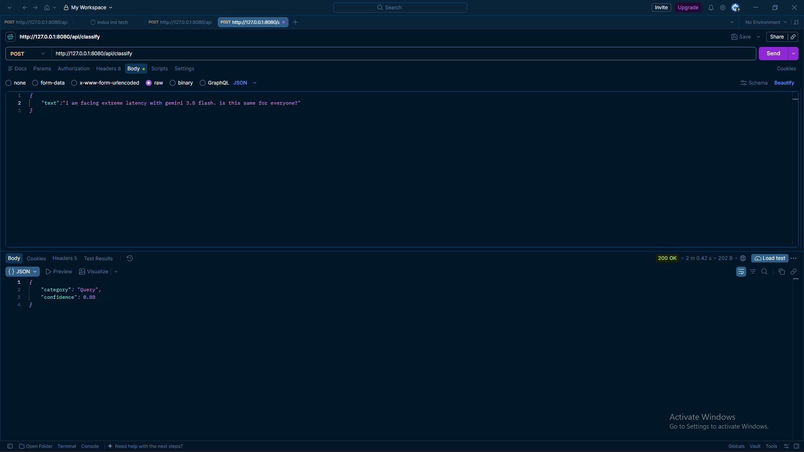
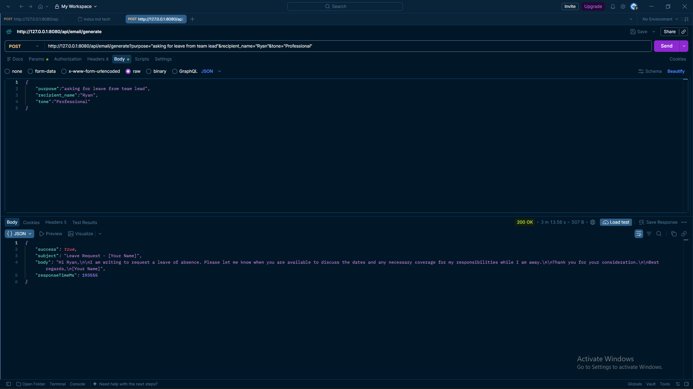

# Assignments

## Assignment 1: AI-Powered Text Classification

A Spring Boot application that classifies user-provided text into one of three primary categories: **Complaint, Query, or Feedback**. The application integrates Google's Gemini 3.8 Flash as its language model, with the AI integration abstracted behind the service layer to keep the model interaction independent of the controller and API-facing logic.

### Processing Pipeline

```text
        Client / Postman
               |
               v
       Text Input (JSON)
               |
               v
       ClassificationController
               |
               v
       ClassificationService
               |
               v
       Prompt Construction
               |
               v
       Gemini 3.8 Flash API
               |
               v
       AI-Generated JSON
               |
               v
       Response Parsing
               |
               v
       Category + Confidence
               |
               v
        JSON API Response
```

### Key Implementation Details

- **REST API:** Accepts user-provided text through an HTTP POST endpoint.
- **AI Integration:** Uses Gemini to understand and classify the submitted text.
- **Structured Output:** Requests a JSON response containing the predicted category and confidence score.
- **Modular Architecture:** Separates API handling, AI communication, and response processing into distinct layers.
- **Model Abstraction:** Keeps the underlying AI interaction encapsulated within the service layer.

### Testing & Observations

During testing, Gemini exhibited significant response latency and frequently returned HTTP 500 errors. These issues affected the consistency of live demonstrations.

Consequently, Postman demonstration screenshots are provided as evidence of the implementation and API interaction.

**Postman Demonstrations**

- **Demonstration 1:**
- 
- **Demonstration 2:**
- 

---

## Assignment 2: AI-Powered Email Template Generator

A Spring Boot microservice that generates short, customer-friendly email templates using Google's Gemini API. It accepts a few structured input fields and generates an email tailored to the specified purpose, recipient, and communication tone.

The service uses `recipient_name` to personalize the email and generates an appropriate subject and body based on the supplied information.

### Processing Pipeline

```text
          Client / Postman
                 |
                 v
         POST /api/email/generate
                 |
                 v
           EmailController
                 |
                 v
         Request Validation
                 |
                 v
            EmailService
                 |
                 v
          Prompt Construction
                 |
                 v
           Gemini REST API
                 |
                 v
         AI-Generated JSON
                 |
                 v
          Response Parsing
                 |
                 v
       Subject + Email Body
                 |
                 v
       Response Time Calculation
                 |
                 v
          JSON API Response
```

### Input Parameters

| Parameter | Description |
|---|---|
| `purpose` | Describes the objective of the email. |
| `recipient_name` | Specifies the recipient's name for personalization. |
| `tone` | Defines the desired communication style, such as Professional, Friendly, or Formal. |

### Key Implementation Details

- **REST API:** Exposes an HTTP POST endpoint for email generation.
- **AI Integration:** Uses Gemini to generate context-aware email content.
- **Prompt Engineering:** Dynamically constructs prompts using the supplied purpose, recipient name, and tone.
- **Structured JSON Output:** Generates an email subject and body in a predictable JSON format.
- **Response Time Logging:** Measures the time taken by the Gemini API call and includes the duration in the API response.
- **Modular Architecture:** Maintains separation between request handling, business logic, and AI integration.
- **Configuration Management:** Stores API configuration and credentials outside the application source code using YAML configuration and environment variables.

### Postman Demonstration

The API was tested using Postman to verify request handling and the generated email response.

**Demonstration:** 


---

## Overall Implementation

Both assignments demonstrate the integration of generative AI into Spring Boot backend applications, with an emphasis on REST API development, modular service architecture, structured JSON communication, and external AI model integration.
